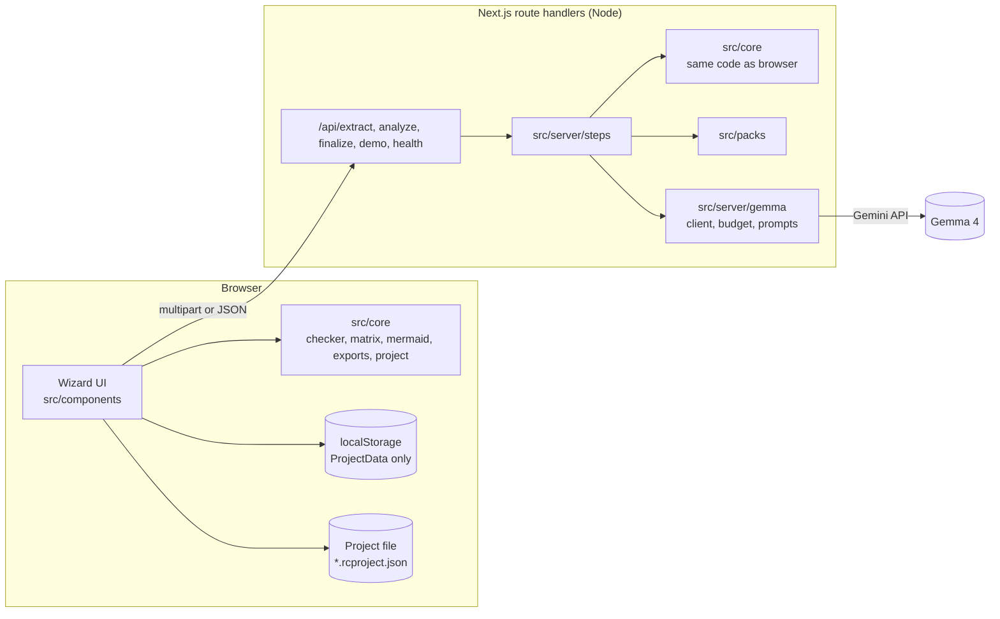
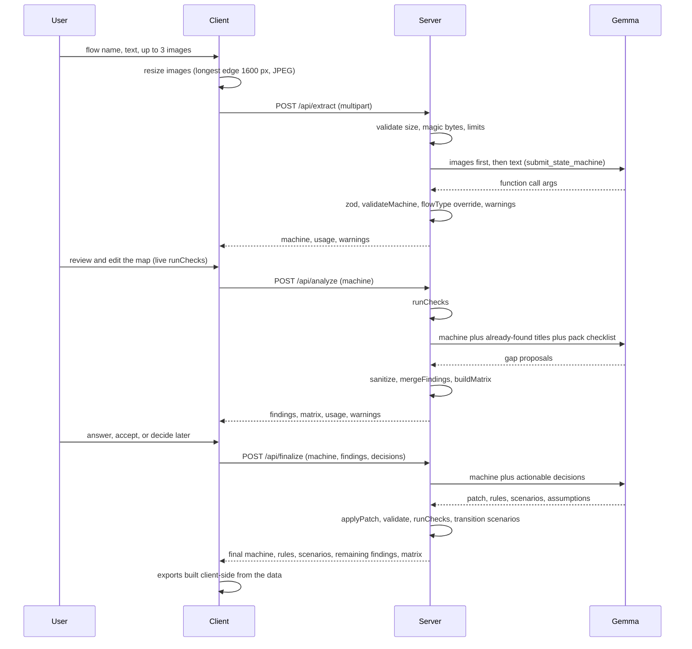

# RealityCompiler: architecture

This file explains how the code is organised and how data moves. It summarizes `SPEC.md` and adds no new rules. If this file and `SPEC.md` disagree, `SPEC.md` wins.

## 1. The shape of the system

One Next.js app (App Router). The route handlers are the backend. There is no separate server, no database and no login in M0 to M6.



The key design rule: **the model proposes, code verifies.** Gemma reads messy input and suggests gaps. Deterministic code in `src/core` decides what is structurally wrong, applies patches, generates transition scenarios and builds every export.

## 2. Layers and import rules

| Layer | Path | May import | Must not import |
|---|---|---|---|
| Core (pure logic) | `src/core` | `zod`, itself | `src/server`, `src/app`, `src/components`, Next, network, Node-only APIs |
| Domain packs | `src/packs` | `src/core` types | UI, server |
| Server | `src/server` | `src/core`, `src/packs`, `@google/genai`, Node | `src/components` |
| API routes | `src/app/api` | `src/server`, `src/core` | `src/components` |
| UI components | `src/components` | `src/core`, UI libraries | `src/server`, `src/packs` |
| Pages | `src/app/page.tsx` (landing), `app/page.tsx` (wizard), `about/`, `contact/`, `layout.tsx` | `src/components`, `src/core` | `src/server` |

`src/core` runs in both the browser and the server. That is why the checker can run live after each edit in Step 2 and again on the server in `/api/analyze`, with identical results.

## 3. Core modules (`src/core`)

| File | Responsibility |
|---|---|
| `types.ts` | zod schemas and inferred types for State, Event, Transition, StateMachine, Finding, Decision, Scenario, Rule, Patch, Usage, and the project-file schemas (SPEC §5, §5.3) |
| `validate.ts` | `validateMachine()`: zod plus integrity rules (unique ids, valid references, at most one initial, initial is never terminal) |
| `checker.ts` | `runChecks()`: the 10 rules of SPEC §6.2, `MISSING_HANDLER` logic of §6.3. Deterministic and ordered |
| `questions.ts` | Templated questions with options for every checker rule (SPEC §6.4). Zero model tokens |
| `matrix.ts` | `buildMatrix()`: reachable non-terminal states by `timeout, failure, cancel, duplicate` with `handled / missing / na` |
| `patch.ts` | `applyPatch()`: add-only, never throws, returns warnings (`PATCH_DUPLICATE_ID`, `PATCH_BAD_REF`, `PATCH_CAP`) |
| `scenarios.ts` | `generateTransitionScenarios()`: one Given/When/Then per transition, guaranteed coverage |
| `mermaid.ts` | `toMermaid()`: sanitized `stateDiagram-v2` text |
| `merge.ts` | `mergeFindings()` and ranking (SPEC §6.6) |
| `project.ts` | `serializeProject`, `parseProjectFile`, `projectFileName`, `emptyProjectData` (SPEC §11.7) |
| `export/` | `spec.ts`, `gherkin.ts`, `playwright.ts`; `machine.json` and `findings.json` are plain `JSON.stringify` |

## 4. What code does and what the model does

| Job | Done by | Why |
|---|---|---|
| Read a sketch or text into states, events, transitions | Gemma (step 1, `minimal` thinking) | Needs vision and language |
| Validate the extracted machine | Code (`validateMachine`) | Model output is untrusted |
| Find dead ends, missing timeout/failure/cancel/duplicate, unreachable states | Code (`runChecks`) | Repeatable and measurable |
| Propose business and risk gaps (money, data, security, timing) | Gemma (step 2, `high` thinking) | Needs judgment, guided by the domain pack checklist |
| Ask questions for structural gaps | Code (`questions.ts`) | Zero tokens, exact wording |
| Turn decisions into patch, rules, behavior scenarios | Gemma (step 3, `minimal` thinking) | Needs language |
| Apply the patch, re-run checks, generate transition scenarios | Code | Guaranteed coverage |
| Build every export file | Code (`src/core/export`) | Exact formats |

## 5. The request pipeline



Step details:

- **Extract** (`steps/extract.ts`): one call, model `GEMMA_MODEL_EXTRACT`. If zod or `validateMachine` fails, one re-ask with the errors appended. A second failure returns `MODEL_OUTPUT_INVALID` (422).
- **Analyze** (`steps/analyze.ts`): runs the checker first, then one call. If the call fails after retries, the request still succeeds with checker findings only and the warning `AI_GAPS_UNAVAILABLE`.
- **Finalize** (`steps/finalize.ts`): if there are no option or custom decisions, skips the model and returns an empty patch. Otherwise one call, one re-ask allowed if the patched machine is invalid.
- **Demo** (`/api/demo`): no model call. Returns the Appendix A machine plus Appendix C gaps. The client runs the checker itself.
- **No function call returned**: one more attempt with an explicit instruction, then try to parse `response.text` as JSON, then `MODEL_OUTPUT_INVALID` (SPEC §7.5).

## 6. Server internals (`src/server`)

| File | Responsibility |
|---|---|
| `env.ts` | Reads and validates env vars with zod. Missing key with `MOCK_GEMMA=0` gives 500 `INTERNAL` with the exact message in SPEC §15, except on `/api/health` |
| `http.ts` | Error helpers using the fixed shape `{ error: { code, message, retryAfterSec? } }`, IP limiter (20 requests per minute per client key), image magic-byte validation |
| `gemma/client.ts` | `GemmaClient` interface and the real implementation: reserve budget, upload images through the Files API, call `generateContent` with a function declaration, read `functionCalls`, read usage, delete uploaded files in `finally`, retry 429/500/503 twice |
| `gemma/mock.ts` | Returns fixtures after 300 ms with zero usage. Active when `MOCK_GEMMA=1` |
| `gemma/declarations.ts` | The three function declarations as plain JSON-schema objects |
| `gemma/prompts.ts` | The three system instructions, copied verbatim from SPEC §7.2 |
| `gemma/budget.ts` | Token budget guard: sliding 60 s window, `TPM_SAFETY` ceiling, one call in flight, at most 25 requests per minute. Never crashes a request |
| `steps/*.ts` | Orchestration of one step each. Depend only on the `GemmaClient` interface, so they run unchanged against the mock |

Order of checks per route: IP limiter, input validation, (M7 only: user check and daily allowance), token budget guard, model call.

## 7. Client architecture (`src/components`, `src/app/app/page.tsx`)

One page, four-step wizard, state in a single `useReducer`:

```
{ step, input, machine, findings, decisions, result }   // persisted as ProjectData
+ images (memory only), tokensUsed (session only), UI flags
```

Rules:

- `toProjectData(state)` drops everything that must not be saved (images, token totals). It is the only function that produces what goes to `localStorage` (key `rc_project_v1`), to a project file, or (M7) to the cloud. Its location is chosen at M4 and logged in `docs/DECISIONS.md`.
- On startup the stored value is parsed with `ProjectDataSchema` and `validateMachine`. If missing or invalid it is discarded silently and the app starts at Step 1.
- All storage access is wrapped in try/catch. The app must work if storage throws.
- Save and Open project file are pure client code with no API route (SPEC §10.5).
- Exports are built in the browser from the result data with `src/core/export` and downloaded as Blobs.

### Component map

| Component | Job |
|---|---|
| `StepHeader` | Wizard progress and step title |
| `InputPanel`, `ImageDropzone`, `PrivacyNotice` | Step 1 form, client-side image resize, privacy and help text |
| `DiagramView` | Mermaid render (client only), with list fallback if rendering throws |
| `MachineEditor` | Step 2 tabs for States, Events, Transitions, plus add forms and the live issue counter |
| `FindingsPanel`, `FindingCard`, `MatrixTable` | Step 3 summary bar, cards with questions and answers, completeness table |
| `ResultTabs`, `ExportPanel` | Step 4 Map, Rules, Scenarios, Open issues, Export |
| `ErrorBanner` | One place that maps error codes to the exact copy in SPEC §10.4 |
| `ProjectFileControls` | Save and Open project file in the page header |

### Visual layering (how the UI libraries fit in)

```
src/components/ui/        vendored primitives: shadcn base, Skiper UI and Watermelon UI source (visual only)
src/components/*.tsx      the spec-named components above (behavior, state wiring, exact strings)
src/lib/utils.ts          the cn() helper that shadcn adds
src/app/globals.css       design tokens as CSS variables (see docs/design.md)
```

- Behavior lives in the spec-named components. Vendored components only provide look and motion.
- Replacing a vendored component must never change behavior, text, or an API call.
- Server components: `layout.tsx` and the landing, About and Contact pages. The wizard `app/page.tsx` and everything under it that holds state is a client component. Site sections live in `src/components/site/`.
- Animation uses the `motion` package. The whole app is wrapped once so reduced-motion preferences are honored (details in `docs/design.md`).

## 8. Error flow

Every route is wrapped by one error helper. Codes are fixed: `VALIDATION` 400, `TOO_LARGE` 413, `MODEL_OUTPUT_INVALID` 422, `RATE_LIMITED` 429 (with `retryAfterSec`), `MODEL_ERROR` 502, `INTERNAL` 500. The client reads the `code` and shows the exact copy from SPEC §10.4 in `ErrorBanner`. Stack traces and env values never reach the client.

## 9. Security and privacy architecture

- The Gemini key exists only in server environment variables. It never reaches the client bundle.
- Images: validated by magic bytes on the server (JPEG, PNG, WEBP), each at most 3 MB, total at most 4 MB, at most 3. Temp files use random names under `os.tmpdir()` and are deleted right after upload. Uploaded Gemini files are deleted after the call (best effort).
- Images are held in browser memory only and are never written to storage, project files or the cloud.
- Model output, project files, user text and image text are all untrusted data. They are validated with zod, never executed, and always rendered as plain text. Mermaid labels are sanitized and Mermaid runs with `securityLevel: 'strict'`.
- No analytics, no third-party scripts, no cookies (M0 to M6), system fonts only.
- Copied UI components must have remote images, fonts and scripts removed so this stays true.

## 10. Testing architecture

- `tests/core/*.test.ts`: checker (fixture yields exactly the 9 findings of Appendix E), validate, patch, scenarios, mermaid, export snapshots, questions, project file.
- `tests/server/*.test.ts`: steps end to end with the mock client (7 findings remain after the mock finalization), budget guard with fake timers, HTTP validation and error shape.
- Manual acceptance (SPEC §14.2) runs with `MOCK_GEMMA=1` and, if a key exists, with the real API.
- `scripts/spike.ts` verifies every [VERIFY] item and writes `docs/SPIKE.md`. `scripts/eval.ts` measures recall against seeded gaps.

## 11. Optional M7 (accounts), kept isolated

Built only if the owner asks. It is active only when both `NEXT_PUBLIC_SUPABASE_URL` and `NEXT_PUBLIC_SUPABASE_ANON_KEY` are set. Without them, no Supabase code runs and the app behaves exactly like M6.

- Supabase Auth (Google and email magic link), a `projects` table and a `usage_daily` table, both with Row Level Security tied to `auth.uid()`.
- The browser talks to Supabase directly with the user's session. The server decides who the user is only with `supabase.auth.getUser()`.
- New files live in `src/lib/supabase/`, `src/lib/cloud.ts`, `src/server/quota.ts`, `src/app/auth/callback/route.ts` and three dialogs. Nothing in M0 to M6 changes.

## 12. Milestones mapped to layers

| Milestone | Layer built | Needs API key |
|---|---|---|
| M0 Scaffold | Project, tooling, folders, design tokens and base UI setup | No |
| M1 Core logic | `src/core`, fixtures, core tests | No |
| M2 Spike | `scripts/spike.ts`, `docs/SPIKE.md` | Yes (else marked NOT TESTED) |
| M3 Server pipeline | `src/server`, `src/packs`, API routes | Optional (mock works) |
| M4 UI | `src/components`, page, project file controls | No (mock mode) |
| M5 Exports and polish | Downloads, copy buttons, loading and error copy, token footer | No |
| M6 Eval and docs | `scripts/eval.ts`, `evals/`, README, FINAL_REPORT | Optional |
| M7 Accounts | Supabase layer | Needs a Supabase project |

## 13. Environment variables

```
GEMINI_API_KEY=            # server only
GEMMA_MODEL_EXTRACT=gemma-4-31b-it
GEMMA_MODEL_ANALYZE=gemma-4-26b-a4b-it
GEMMA_MODEL_FINALIZE=gemma-4-26b-a4b-it
MOCK_GEMMA=0
TPM_LIMIT=16000
TPM_SAFETY=14000
```

M7 adds `NEXT_PUBLIC_SUPABASE_URL`, `NEXT_PUBLIC_SUPABASE_ANON_KEY`, `REQUIRE_LOGIN_FOR_AI` and `DAILY_TOKENS_PER_USER`. There is never a service-role variable.
